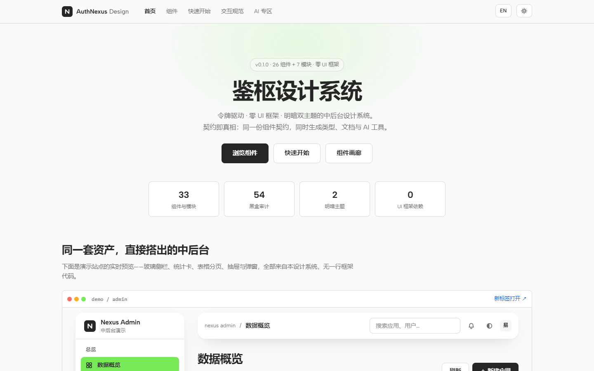
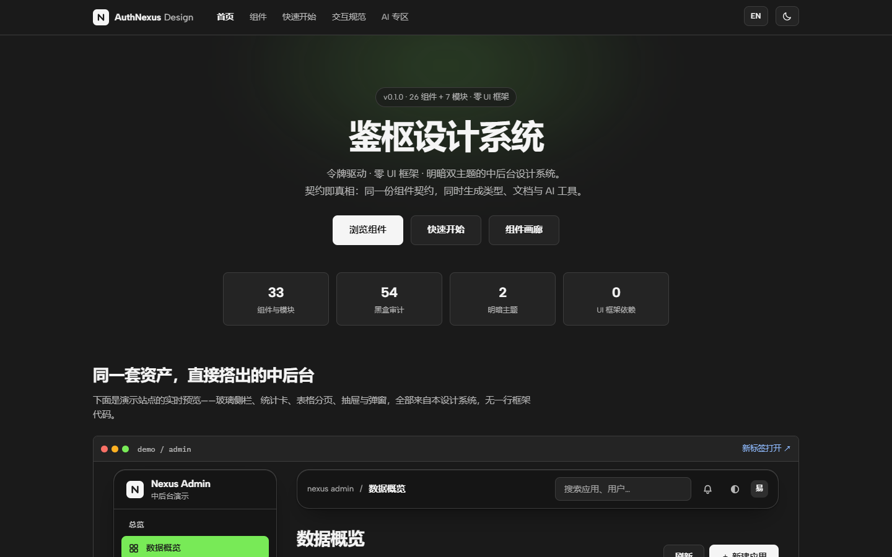

<p align="center">
  <picture>
    <source media="(prefers-color-scheme: dark)" srcset="brand/logo-dark.svg">
    
  </picture>
</p>

<h1 align="center">AuthNexus Design</h1>

<p align="center">
  <b>鉴枢设计系统</b> · 令牌驱动、零 UI 框架的中后台设计系统<br/>
  纸白画布 · 墨黑文字 · 1px 描边分层 · 液态玻璃浮层 · 酸橙绿只做品牌时刻
</p>

<p align="center">
  <a href="https://authnexus-design.casuainess.cn"></a>
  <a href="https://authnexus-design.casuainess.cn/demo/admin/"></a>
  
  
  
  
</p>

<p align="center">
  <a href="https://authnexus-design.casuainess.cn">官网</a> ·
  <a href="https://authnexus-design.casuainess.cn/components/">组件总览</a> ·
  <a href="https://authnexus-design.casuainess.cn/guide/">快速开始</a> ·
  <a href="https://authnexus-design.casuainess.cn/guide/spec.html">交互规范</a> ·
  <a href="https://authnexus-design.casuainess.cn/ai/">AI 专区</a>
</p>

---

## 为什么是鉴枢

| 约束 | 换来的确定性 |
|---|---|
| **令牌驱动** | 改一处 `--acid` 全站换色；明暗双主题共用同一份组件代码 |
| **零 UI 框架** | 七个 CSS 文件 + 26 个自绘组件，没有运行时 UI 库 |
| **契约即真相** | 33 份契约同时生成类型、文档与 MCP 工具描述，四端不漂移 |
| **黑盒审计** | 玻璃、浮层、对比度、动效写成 54 项浏览器断言 |
| **AI 就绪** | MCP 4 个工具给模型真实令牌值与 class 契约，7 条 lint 把铁律变成检查 |
| **中后台基因** | 玻璃外壳、分页滑动、抽屉表单、命令式浮层，为控制台场景而生 |

## 预览

<table>
  <tr>
    <td width="50%"></td>
    <td width="50%"></td>
  </tr>
  <tr>
    <td align="center"><sub>浅色主题</sub></td>
    <td align="center"><sub>深色主题</sub></td>
  </tr>
</table>

## 快速开始

### Vue 3

```bash
# 1. 取资产（推荐直接复制，不经过包管理器）
git clone https://github.com/YimoLab/authnexus-design.git
cp -r authnexus-design/css authnexus-design/fonts ./vendor/authnexus-design/

# 2. 按需复制组件源码
cp -r authnexus-design/vue ./vendor/authnexus-design/
```

```html
<!-- 3. 引入字体与单一 CSS 入口（index.css 已保证内部顺序） -->
<link rel="stylesheet" href="./vendor/authnexus-design/fonts/fonts.css" />
<link rel="stylesheet" href="./vendor/authnexus-design/css/index.css" />

<!-- 4. body 内保留两个 Teleport 容器（缺了浮层与 Toast 不会显示） -->
<div id="overlay-layer" class="anx-overlay-layer"></div>
<div id="toast-layer" class="anx-toast-layer" role="region" aria-live="polite" aria-label="操作通知"></div>
```

```ts
// 5. 应用根挂载两个 Host
import OverlayHost from './vendor/authnexus-design/vue/overlay/OverlayHost.vue'
import ToastHost from './vendor/authnexus-design/vue/overlay/ToastHost.vue'
```

完整五步、主题预置与验收清单见 [`docs/ADOPT.md`](docs/ADOPT.md)。

### React

复用同一套 `css/` 资产，按 [`docs/BEHAVIOR.md`](docs/BEHAVIOR.md) 实现组件；跨框架一致性由 `audit/` 验收。

> **核心纪律：迁移 = 复制文件 + 改 import，禁止重写组件。**

## 组件与模块

26 个 Vue 组件 + 7 个逻辑模块，全部在 `anx-` 命名空间。

| 分组 | 数量 | 组件 |
|---|---:|---|
| 浮层 | 9 | `ModalShell` `DrawerShell` `ConfirmDialog` `ToastHost` `OverlayHost` `OverlaySlot` + `manager` `toast` `overlayState` |
| 展示 | 7 | `Icon` `Badge` `AlertBox` `EmptyState` `QrCode` `TimelineList` `UserAvatar` |
| 表单 | 4 | `FieldInput` `SelectMenu` `SegmentedControl` `ImagePicker` |
| 数据展示 | 4 | `CodeBox` `KvList` `StatCard` `TablePager` |
| 逻辑 | 4 | `theme` `usePager` `qr` `icons` |
| 布局 | 3 | `PageHead` `PanelBlock` `RouteFade` |
| 导航 | 1 | `TabBar` |
| 反馈 | 1 | `RouteSkeleton` |

每个组件的 props / emits / slots / class 契约：[官网组件总览](https://authnexus-design.casuainess.cn/components/) · [`contracts/components/`](contracts/components/)。

## 契约即真相

```text
contracts/components/*.json   ← 唯一数据源（33 份）
        │
        ├─→ dist/vue.d.ts               组件类型（props / emits / slots）
        ├─→ dist/index.d.ts             逻辑模块签名
        ├─→ contracts/generated/api.md  API 文档
        └─→ mcp/server.mjs              MCP 工具描述
```

改组件后重跑两条命令，四端不漂移：

```bash
python tools/extract-contracts.py   # 源码 → 契约
node tools/gen-types.mjs            # 契约 → 类型 + API 文档
```

## 工程与验收

```bash
node tools/lint-usage.mjs <文件或目录>   # 把交互铁律变成静态检查
python tools/validate-contracts.py       # 契约合法性
python -m http.server 8123               # 先起静态服务
node audit/audit-gallery.mjs             # 组件级浏览器黑盒审计
npm run build:site                       # 构建官网 _site/
```

## 目录

| 路径 | 职责 |
|---|---|
| `css/` | 设计令牌、品牌层、基础样式、组件配方、动效、中后台外壳（单入口 `css/index.css`） |
| `vue/` | Vue 3 组件源码（`ui/`、`overlay/`、`lib/`） |
| `contracts/` | 33 份组件契约（唯一数据源） |
| `brand/` | 品牌 SVG、OG 分享图、iOS 主屏图标 |
| `fonts/` | 自托管 Albert Sans / IBM Plex Mono（OFL 1.1） |
| `mcp/` | 面向 AI 的 MCP Server（4 个工具，零依赖） |
| `audit/` | 浏览器黑盒审计（组件级 + 页面级） |
| `tools/` | 契约提取、类型生成、站点构建、lint、校验 |
| `gallery/` | 纯静态样式画廊（零框架、双主题） |
| `demo/` | 中后台演示（官网首页实时预览） |
| `examples/` | Vue 接线示例 + React 接线骨架 |
| `docs/` | ADOPT / BEHAVIOR / 命名空间迁移 |
| `_site/` | 官网构建产物（`npm run build:site`） |

## 文档

- [接入指南](docs/ADOPT.md)
- [交互规范](docs/BEHAVIOR.md)
- [命名空间迁移](docs/NAMESPACE-MIGRATION.md)
- [更新日志](CHANGELOG.md)

## 三平台仓库

| 平台 | 地址 |
|---|---|
| GitHub | https://github.com/YimoLab/authnexus-design |
| Codeberg | https://codeberg.org/YimoLab/authnexus-design |
| Gitee | https://gitee.com/YimoLab/authnexus-design |

## 许可证

- 代码与样式：[MIT](LICENSE)
- 字体：[SIL Open Font License 1.1](fonts/OFL-AlbertSans.txt)（Albert Sans）、[SIL OFL 1.1](fonts/OFL-IBMPlexMono.txt)（IBM Plex Mono）

---

<p align="center"><sub>官网与文档站本身由鉴枢设计系统搭建。</sub></p>
